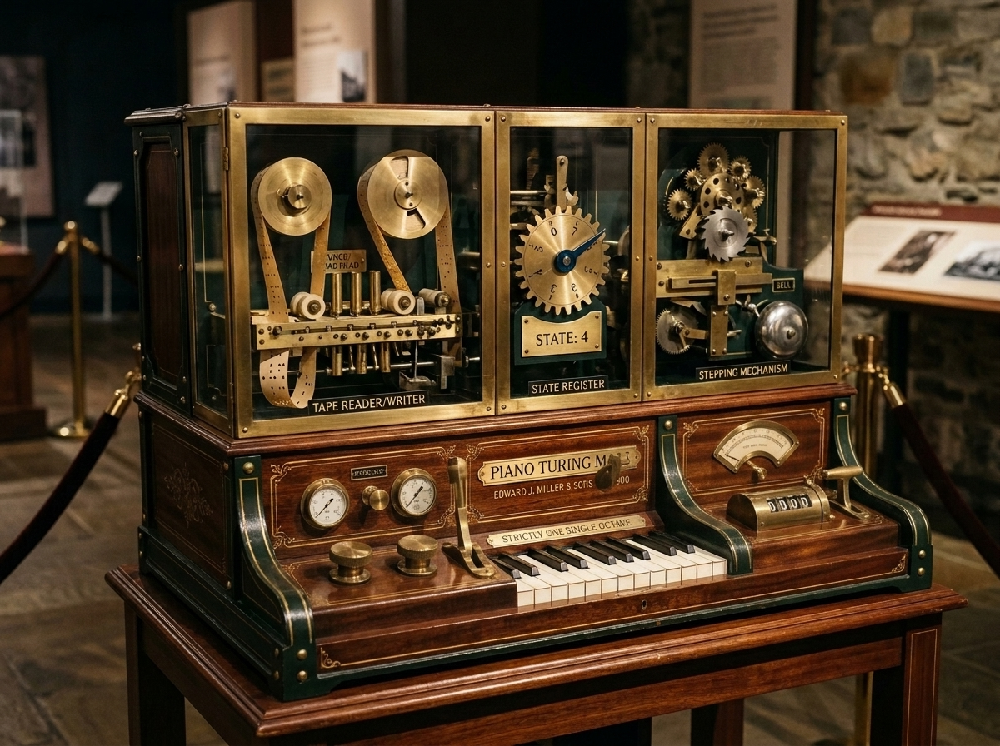
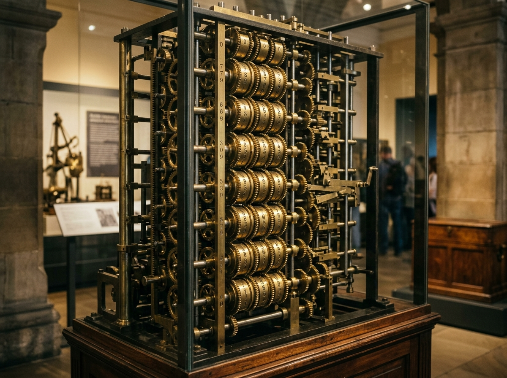
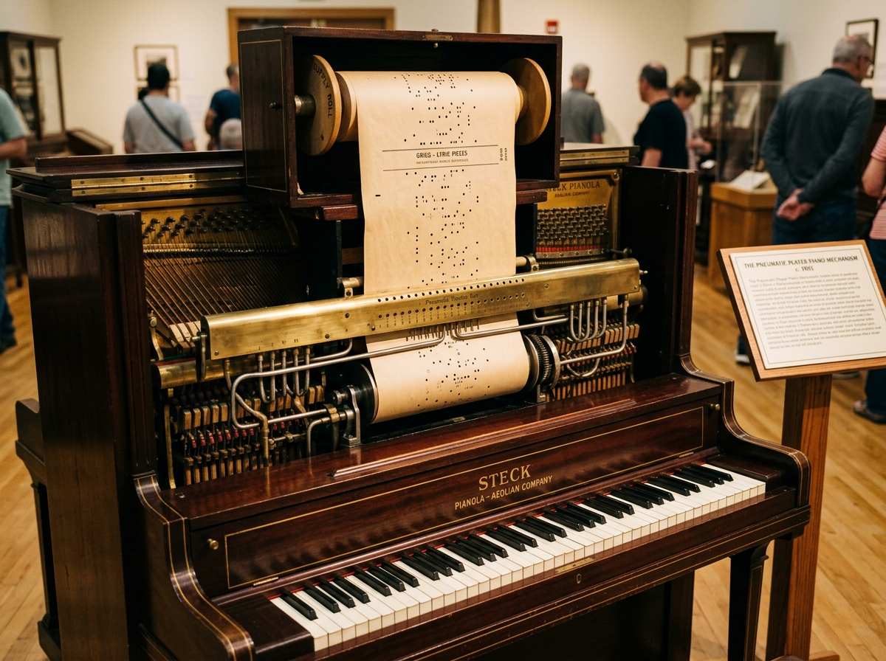

# Piano Turing Machine — What if player pianos had bidirectional tapes?



An interactive alternate-history **1900s pneumatic & clockwork computing exhibit** built with React, TypeScript, Vite, and Web Audio / Tone.js.

---

## 1. The Concept: The 1900 Missing Link of Computing

In the history of computing, there is a century-long conceptual gap between **19th-century mechanical calculators** (built from brass gears) and **Alan Turing's 1936 universal machine** (conceived as pure mathematical symbols on an infinite tape).

Yet every physical component needed to build a working Turing machine already existed in **1900**—inside a parlor player piano and a mechanical desk calculator:

| 1642 – 1830s · Gear Calculators | 1900s · The Player Piano (*Pianola*) | 1936 → 1900 · Piano Turing Machine |
| :---: | :---: | :---: |
|  |  |  |
| **Pascal & Babbage's Fixed Columns**<br/>Every digit required its own physical brass gear wheel. Computing 40-digit numbers meant machining 40 interlocking gear columns—strictly bounded by hardware size. | **Perforated Paper & Tracker Bar**<br/>Perforated paper rolls glided over a brass **Tracker Bar**. Whenever a punched hole passed an air port, vacuum suction tripped a pneumatic striker to play a piano key. | **Bidirectional Tape + 1-Bit Ratchet**<br/>Instead of 40 gear columns for 40 bits, a **single 1-bit ratchet wheel** shuttles back and forth across a **bidirectional paper tape**—computing numbers of *unlimited length*. |

**Why this matters:** Moving memory off the gears and onto a scrollable paper tape is the exact leap from a fixed calculator to a general-purpose computer. Swapping the cam wheel on the **9-Gear Rotary Turret** transforms the same 4-notch ratchet into a mechanical **ALU** capable of arithmetic and bitwise logic.

---

## 2. The Three Mechanical Assemblies

1. **Bidirectional Paper Tape & Pneumatic Tracker Bar (Left Bay)**
   - Acts as both unbounded memory and I/O (`RAW` binary, `OCT` octal, and `DEC` decimal readouts).
   - During stages **① `q1` (Read A)** and **② `q2` (Read B)**, a spring-loaded brass feeler pin probes the cell under the playhead:
     - **Open Hole (`1`)**: Pin drops through the perforation, admitting air to stroke the driving pawl `+1 tooth` (`−1` for borrow in `SUB`).
     - **Solid Paper (`0`)**: Pin is blocked by unpunched paper (`+0 tooth`).
     - **Twin Holes (`#`) / Double Slot (`=`)**: Delimit the input operands and the punched output region.

2. **8-Tooth State Spur Gear (Center Bay)**
   - A single brass spur gear serves as the machine's finite state register (`INPUT → SCAN → q1 → q2 → q3 → q4 → WRITE → HALT`), coordinating tape shuttle direction and mechanical phases.

3. **Rotary Gear Turret & 4-Notch Arithmetic Ratchet (Right Bay)**
   - **4-Notch Ratchet Wheel (`0 · 1 · 2 · 3`)**: Accumulates the per-bit mechanical total (`A + B + Carry`).
   - **Cam Follower (`③ q3`)**: Raised orange cam lobes (`LOBE 1` vs `VALLEY 0`) trigger the punch hammer to stamp the result bit onto the right end of the tape.
   - **Carry / Borrow Latch (`④ q4`)**: When the ratchet reaches a carry notch (`≥ 2` in `ADD`), a sliding brass bolt locks (`LOCK 1`) and pre-advances the ratchet on the next bit to the left.

---

## 3. The 9-Gear Rotary Turret (Mechanical ALU)

Rotate the revolver-style turret by clicking any station on the wheel or pressing **`A♯4 (U)` / `B4 (J)`**:

| Gear | Formula | Tape Format | Cam Lobes (`1`) | Carry / Borrow Latch | Mechanical Principle |
| :--- | :--- | :--- | :---: | :---: | :--- |
| **`ADD`** | `A + B` | `A#B` | `1, 3` | Lock at `2, 3` | Odd-parity cam (`1, 3`) + 2-tooth carry step |
| **`SUB`** | `A − B` | `A#B` (`A ≥ B`) | `1, 3` | Borrow at `< 0` | Reverse pawl on `B` (`A − B − Borrow`) |
| **`MUL`** | `A × B` | `A#B` | `1, 3` | Lock at `2, 3` | Shift-and-add multiplier across bit positions |
| **`AND`** | `A & B` | `A#B` | `2` | Unhooked | Coincidence cam (high only when both `A=1` and `B=1`) |
| **`OR`** | `A \| B` | `A#B` | `1, 2, 3` | Unhooked | Broad-lobe cam (high when any hole admits air) |
| **`XOR`** | `A ^ B` | `A#B` | `1` | Unhooked | Single-lobe odd parity without carry linkage |
| **`INC`** | `A + 1` | `A` | `1, 2` | Lock at `2` | Pre-cocked carry latch adds `+1` at LSB |
| **`SHL`** | `A << 1` | `A` | `1, 3` | Unhooked | Appends a `0` at LSB and copies `A` shifted left |
| **`NOT`** | `~A` | `A` | `0` | Unhooked | Inverted cam follower (stamps `1` on solid paper `0`) |

---

## 4. Single-Octave Piano Keyboard (`C4–B4`)

Every operation is controlled from a single 12-key octave (`C4` to `B4`):

| Piano Key | Solfège / Note | Keyboard Shortcut | Mechanical Action |
| :--- | :--- | :---: | :--- |
| **White Key 1** | `Do` (`C4`) | <kbd>A</kbd> | `←` Move tape head Left |
| **Black Key 1** | `C♯4` | <kbd>W</kbd> | `⏭` Step 1 mechanical stage |
| **White Key 2** | `Re` (`D4`) | <kbd>S</kbd> | `→` Move tape head Right |
| **Black Key 2** | `D♯4` | <kbd>E</kbd> | `↺` Reset head (or clear finished tape) |
| **White Key 3** | `Mi` (`E4`) | <kbd>D</kbd> | `1` Punch open hole (`1`) on current cell |
| **White Key 4** | `Fa` (`F4`) | <kbd>F</kbd> | `0` Punch solid mark (`0`) on current cell |
| **Black Key 3** | `F♯4` | <kbd>T</kbd> | `▶` Play / auto-step clockwork |
| **White Key 5** | `So` (`G4`) | <kbd>G</kbd> | `□` Clear current cell to blank |
| **Black Key 4** | `G♯4` | <kbd>Y</kbd> | `⏸` Pause clockwork |
| **White Key 6** | `La` (`A4`) | <kbd>H</kbd> | `#` Punch operand separator (`#`) |
| **Black Key 5** | `A♯4` | <kbd>U</kbd> | `◀⚙` Rotate Gear Turret backward |
| **White Key 7** | `Si` (`B4`) | <kbd>J</kbd> | `⚙▶` Rotate Gear Turret forward |

### Quick Demo: Computing `1 + 1 = 2` (`1#1=10`)

Punching a symbol writes onto the **current cell** without advancing the tape head, so move right one cell between each symbol:

1. Press <kbd>D</kbd> (`Mi · 1`) — Punch first operand `1`
2. Press <kbd>S</kbd> (`Re · →`) — Move tape head right one cell
3. Press <kbd>H</kbd> (`La · #`) — Punch separator `#`
4. Press <kbd>S</kbd> (`Re · →`) — Move tape head right one cell
5. Press <kbd>D</kbd> (`Mi · 1`) — Punch second operand `1`
6. Press <kbd>T</kbd> (`F♯ · ▶ Play`) or <kbd>W</kbd> (`C♯ · ⏭ Step`) — Watch the 4-stage clockwork probe `1#1` and stamp `=10` (`DEC 1#1=2`).

*(Press <kbd>?</kbd> at any time to open the Curator's Note & Operator's Manual.)*

---

## 5. Development

```bash
npm install
npm run dev      # Start Vite dev server
npm test         # Run Vitest unit tests
npm run build    # Type-check and build production bundle
```

